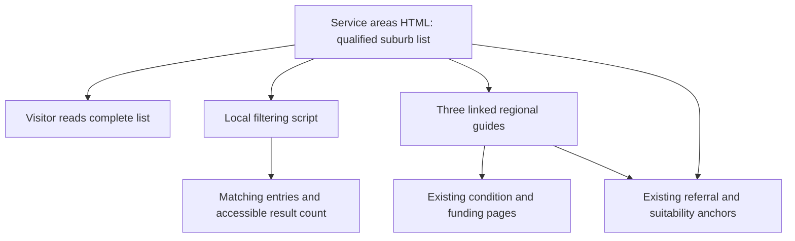
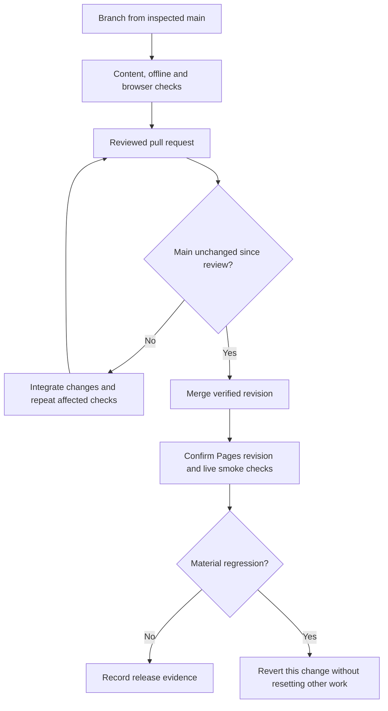

# Tandem Physio Search Visibility - Plan

## Goal Capsule

- **Objective:** People seeking mobile neurological and complex disability physiotherapy can discover Tandem Physio, understand whether their suburb and needs may be suitable, and reach the existing referral pathway.
- **Means:** Strengthen the existing static website with an HTML suburb directory, three regional guides and accurate search metadata (KTD1–KTD5).
- **Authority:** The current user request governs scope and publication. Existing deployed content and repository checks establish the preservation baseline; official search documentation governs search eligibility.
- **Execution:** Deliver through a reviewed pull request, verify the exact revision, publish when release checks pass, and verify the live result (KTD6).
- **Stop conditions:** Do not publish a change with an unresolved critical defect, an unreviewed conflict, an unsupported factual claim, or uncertainty over which revision will deploy. Continue independent work when an owner account action is unavailable.
- **Completion owner:** The implementing agent completes site changes and the authorised release. The owner completes account verification and identity-dependent third-party actions identified in U6.

---

## Product Contract

### Summary

Make the service-area page searchable without requiring JavaScript to expose its contents. Add three useful regional guides reached through ordinary content links. Improve existing pages' search descriptions, structured data and discovery while retaining the current site and referral experience.

### Problem Frame

The deployed site already has 18 substantive pages, eight condition pages and a qualified regional service-area summary. It names 18 suburbs but offers no suburb search or regional guides. Search engines need accurate crawlable content; neither a long suburb list nor extra pages guarantees rankings.

### Requirements

**Coverage and useful content**

- R1. Cover the owner-confirmed geographical area bounded by Glenorie to the north, Penrith to the west, Liverpool to the south and Parramatta to the east, including smaller suburbs verified against authoritative NSW geography; availability remains subject to clinical fit, travel feasibility, funding and current capacity.
- R2. Show all directory entries in the delivered HTML and let visitors filter them by suburb without submitting information.
- R3. A missing suburb produces an invitation to enquire, never a claim that the suburb is excluded.
- R4. Add three regional guides with distinct useful visit or referral guidance and contextual links, omitted from primary navigation.
- R5. Strengthen the existing homepage, clinical-focus page, condition pages and service-area content where evidence identifies a gap; preserve their current substantive information.

**Accuracy, privacy and presentation**

- R6. Keep contact details consistent with the deployed official website: referrals@tandemphysio.com.au and 0410 048 142.
- R7. Preserve accurate clinical, credential and conditional funding statements; do not invent endorsements, specialist status, outcomes, local premises or affiliations.
- R8. Publish no residential address, patient information or new personal information.
- R9. Preserve layout, navigation, images and referral functionality, use Australian English, and make headings black without recolouring the brand controls.

**Search and release**

- R10. Substantive pages have unique descriptive metadata, matching canonical URLs, valid truthful structured data where useful, and crawlable internal links.
- R11. The sitemap contains exactly the indexable substantive pages; utility pages retain their existing noindex contract, and search crawlers can access public content.
- R12. Changes pass repository checks, browser review and content review before publication; the release preserves concurrent work.
- R13. Deliver an evidence-based change log, owner-only account actions, maintenance instructions and a monitoring plan without guaranteeing ranking or AI citation results.

### Acceptance Examples

- AE1. Covers R1–R3: with JavaScript disabled, a visitor can read every verified suburb entry and the availability qualification.
- AE2. Covers R2–R3: searching for `  bOx HiLl  ` shows Box Hill NSW; clearing the field restores all entries; searching for an unlisted suburb leaves an enquiry option.
- AE3. Covers R4: a visitor arriving directly on the Hills guide can understand the home-visit service, see its qualified coverage, read relevant clinical information and reach the existing suitability anchor.
- AE4. Covers R8–R9: visiting a new guide and following its referral link reaches the existing PracSuite referral page without collecting information in the directory.

### Scope Boundaries

No one-page-per-suburb rollout, fabricated suburb names or unsupported boundary claims, keyword-only pages, hidden crawler-only text, purchased links, fabricated reviews, ranking guarantees or invented clinic addresses. Do not add a framework, CMS, database, live search endpoint or separate neurological service page: the existing static structure and clinical-focus page serve this work.

Do not add postcode search until a maintained, verified postcode source is available. Do not add analytics, enquiry tracking or automated search monitoring: this request can be verified without introducing data collection or recurring account activity. The owner has confirmed the broad geographical envelope; its smaller suburbs must be researched and included rather than restricting the work to the previously published names. Future changes beyond that envelope require owner confirmation.

---

## Planning Contract

### Repository Baseline

The inspected baseline is `4cfc767`, the merge of the PracSuite referral change. The deployed pages match that revision. GitHub Pages serves the repository root from `main`, with HTTPS enforced; there is no application build step. No open pull request or repository-specific agent/configuration files were found at intake. Recheck remote state at release because these observations are time-bound.

`scripts/check_site.py` explicitly classifies root HTML pages and checks links, fragments, assets, JSON-LD parsing, metadata, sitemap and robots. `scripts/check_clinical_pages.py` asserts the eight condition titles and discovery links. `scripts/check_visuals.py` protects the exact PracSuite iframe, resize resources, fallback link, referral anchors, privacy links and service-area disclaimer. Shared styles live in `assets/site.css` and `assets/visuals.css`; progressive navigation and reveal behaviour live in `assets/site.js`.

### Key Technical Decisions

- KTD1. **Keep one authoritative HTML directory.** Add a semantic list below the existing service-area diagram in `service-areas.html`; a small local script filters its visible entries. No generated data copy or network request is needed for the researched suburb list, including 100+ entries if supported by the geography. This implements R2 and avoids a new build dependency.
- KTD2. **Build the full owner-confirmed area from verified geography.** Use authoritative NSW suburb/locality data or official council suburb lists to assemble the names within the R1 envelope, including smaller suburbs. Retain the existing 18 published names and Box Hill NSW. Record the sources and boundary-selection rationale in the maintenance evidence; inspect edge locations and label travel as subject to confirmation rather than asserting a precise service boundary. Do not use a target count as evidence, or stop at the existing names. Geographic research may run during implementation because the owner has settled the coverage intent; it is a completion gate before publishing the list.
- KTD3. **Use three root-level regional guides.** Create `hills-district-physiotherapy.html`, `blacktown-physiotherapy.html` and `parramatta-physiotherapy.html`. Root filenames follow the site's existing URL and validator conventions. Each guide must satisfy R4 with concrete regional coverage and a distinct practical emphasis; do not invent facilities, travel times or partnerships. Link from the existing service-area context and relevant service content. This applies Google's [doorway and scaled-content policies](https://developers.google.com/search/docs/essentials/spam-policies).
- KTD4. **Use address-free organisation identity.** Replace the homepage's partial-address `MedicalBusiness` markup with an accurate `Organization` entity and stable identifier. Use page/service/breadcrumb markup only where it describes visible content. Google's [Organization guidance](https://developers.google.com/search/docs/appearance/structured-data/organization) permits this choice, while its [LocalBusiness rich-result guidance](https://developers.google.com/search/docs/appearance/structured-data/local-business) requires a physical address. This is the implementation choice for R7–R8, not a promise of a rich result.
- KTD5. **Use ordinary indexing controls for AI visibility.** Follow Google's [current AI optimisation guidance](https://developers.google.com/search/docs/fundamentals/ai-optimization-guide?hl=en): meaningful text, crawlable links and consistent page information. Preserve the current unrestricted GPTBot posture; if explicit crawler groups are added, keep OAI-SearchBot and Googlebot allowed. [OpenAI's bot documentation](https://developers.openai.com/api/docs/bots) distinguishes search discovery from training. Do not add special AI files or markup without a demonstrated requirement.
- KTD6. **Release the reviewed revision without replacing concurrent work.** Use an isolated branch and pull request. Before merge, compare the current base with the reviewed base; integrate intervening changes and rerun affected checks if it has advanced. Merge only the reviewed and verified revision, then confirm the Pages deployment and live responses. Never force-push the deployment branch. If the release causes a material regression, revert this change through a new reviewed commit rather than resetting unrelated history.
- KTD7. **Keep browser behaviour progressive.** Hide the search controls until their handlers are ready, but keep the list available by default. Apply case-insensitive, trimmed text filtering; announce the result count without moving focus. Search input remains local to the browser. The existing menu, reveal script and referral embed continue unchanged under R9.

### High-Level Technical Design

### Assumptions and Deferred Details

The official website establishes current contact and service facts; stale search snippets do not prove a current defect. The owner confirms the R1 envelope, including smaller suburbs. Exact suburb membership requires source-backed geographic research under KTD2 before publication. Exact copy and CSS selectors remain implementation details under R1–R11. Account permissions and available search reports are execution-time checks, not blockers to website improvements.

### Risks and Dependencies

All new regional content must be useful independently of its links; swapping suburb names in a template is insufficient under KTD3. Existing funding copy says self-managed and plan-managed NDIS only, Tandem is not NDIS-registered, and Support at Home is arranged through a registered provider. DVA, workers compensation and iCare/LTCS retain their approval and eligibility qualifications. Do not turn these into unconditional eligibility claims in new metadata or schema.

GitHub Pages may update after the merge completes, so a merge alone does not establish publication. Third-party PracSuite may restrict local embedding to the approved domain; inspect integration structure and the live domain before classifying a local restriction as a defect. Never submit a real or fabricated patient referral as a test.

---

## Implementation Units

### U1. Searchable qualified suburb directory
- **Goal:** Let visitors check the full researched suburb list within the owner-confirmed area while preserving crawlability.
- **Requirements:** R1–R3, R8–R9; AE1–AE2. **Dependencies:** None.
- **Files:** `service-areas.html`, `assets/service-areas.js` (new), `assets/site.css`, `scripts/check_service_areas.py` (new), `README.md`.
- **Approach:** Complete the KTD2 geographic inventory, including the smaller suburbs, then implement KTD1 and KTD7 below the existing area diagram. Keep its current text and disclaimers. Add a visible search label, reset control, count and unlisted-suburb enquiry state. Document the entry format and how to add or remove a confirmed suburb.

**Test scenarios:**

- Covers AE1: delivered HTML contains every entry in the evidence-backed geographic inventory exactly once and the qualification, independent of script execution.
- Covers AE2: mixed case and surrounding whitespace find Box Hill; an empty query restores every entry.
- An unlisted name shows zero matches and a suitability link without asserting that the business does not travel there.
- Keyboard users can search and reset; result updates are announced, focus stays in the field and the list remains usable at 200% zoom.
- With script loading blocked, the entire list is visible and no nonfunctional search controls are presented.
- **Verification:** Reconcile the published names with the geographical inventory, source evidence and boundary decisions. Structural checks validate directory content, links and unique IDs; browser checks establish filtering and fallback behaviour.

### U2. Three useful regional guides
- **Goal:** Give local search visitors sufficient context to assess a mobile visit and enquire.
- **Requirements:** R1, R4, R6–R9; AE3–AE4. **Dependencies:** U1.
- **Files:** `hills-district-physiotherapy.html` (new), `blacktown-physiotherapy.html` (new), `parramatta-physiotherapy.html` (new), `service-areas.html`, `clinical-focus.html`, `scripts/check_service_areas.py`.
- **Approach:** Apply KTD3 using existing page shells. The Hills guide includes Box Hill and established Hills coverage with practical home-access and daily-routine considerations. The Blacktown guide covers its named North West suburbs with useful supported-accommodation and care-team referral planning. The Parramatta guide covers Parramatta, Westmead, Northmead and Winston Hills with practical continuity of rehabilitation at home. These are visit-planning topics, not claims of partnerships or different clinical eligibility by region. Give each page relevant condition, funding, service-area and suitability links.

**Test scenarios:**

- Covers AE3: each page explains home/community delivery, qualified regional coverage and the next step using ordinary HTML links.
- Every guide is reachable from service-area content and absent from primary navigation.
- Covers AE4: referral links resolve to existing anchors, without replacing the form or adding a second intake flow.
- Each guide has one H1 and a distinct title, description and main content; review rejects text whose only useful difference is a region name.
- **Verification:** The guides read as useful pages independently, pass link checks, and remain usable on mobile without navigation growth.

### U3. Existing page relevance, metadata and structured data
- **Goal:** Make the current offering, location relevance and organisation identity clearer to visitors and crawlers.
- **Requirements:** R5–R10. **Dependencies:** U2.
- **Files:** `index.html`, `clinical-focus.html`, `service-areas.html`, the three new regional pages, condition HTML pages only where review warrants changes, `assets/site.css`, `assets/home.css` if its heading overrides require adjustment, `scripts/check_site.py`, `scripts/check_clinical_pages.py`, `scripts/check_service_areas.py`.
- **Approach:** Apply KTD4 and retain the current contact and funding facts. Improve homepage and clinical-focus title/description/H1 only where they help express mobile neurological and complex disability physiotherapy in the relevant geography. Audit condition metadata and retain already useful unique descriptions. Add natural contextual regional links where useful. Make heading colour black through narrow selectors; check all stylesheet overrides rather than changing the brand token.

**Test scenarios:**

- Each changed page has one descriptive title, one description and matching canonical/Open Graph URLs.
- Organisation markup parses, uses the verified email and phone, and contains no invented address, rating, registration or affiliation.
- Page and service markup agree with visible content and resolve references to the organisation consistently.
- Existing condition discovery links, funding qualifications and all visible contact details remain accurate.
- Heading text renders black on homepage, existing service pages and new guides without making controls unreadable.
- **Verification:** Validate schema syntax and semantics separately; report any Google rich-result eligibility limits accurately. Content review compares changed prose against the deployed baseline.

### U4. Crawlability, inventories and regression checks
- **Goal:** Keep the static site's search inventory and verification scripts aligned with the new pages.
- **Requirements:** R10–R12. **Dependencies:** U2, U3.
- **Files:** `sitemap.xml`, `robots.txt` only if a justified change is needed, `scripts/check_site.py`, `scripts/test_check_site.py`, `scripts/check_service_areas.py`, `README.md`.
- **Approach:** Add the three guides to the explicit substantive-page inventory and sitemap. Preserve canonical apex HTTPS URLs and utility-page noindex directives. Apply KTD5 without treating an already permissive robots file as defective. Add focused negative cases for new metadata, directory and discovery guarantees rather than duplicating every existing check.

**Test scenarios:**

- All 21 substantive pages appear once in the sitemap and have reachable canonical URLs; `thanks.html` and `404.html` remain excluded.
- A missing guide, broken contextual link or invalid schema is rejected by the offline checks.
- A new substantive page containing noindex is rejected; robots permits public page crawling and references the canonical sitemap once.
- Existing PracSuite iframe URL, resize assets, fallback link, privacy links and referral anchors still satisfy the unchanged visual checker.
- **Verification:** All existing baseline scripts and the focused new checker pass. No placeholder date is added to sitemap lastmod fields.

### U5. Review and publish the verified revision
- **Goal:** Publish the requested improvements safely and prove the deployed result.
- **Requirements:** R9, R12. **Dependencies:** U1–U4.
- **Files:** Pull-request diff, existing validation scripts, release evidence outside public website content.
- **Approach:** Apply KTD6. Review both factual content and the code diff before merge. Validate the local pages at mobile, tablet and desktop widths, then repeat live smoke checks after Pages reports the intended revision. Keep temporary browser assets and audit scratch files outside the deployed site.

**Test scenarios:**

- Search and reset work at 375 px, 768 px and 1280 px widths without horizontal overflow or overlapping controls.
- The mobile menu, keyboard focus, skip link, reduced-motion state and visible heading contrast remain usable.
- A direct request for each new URL returns the intended page on apex HTTPS; existing referral and condition URLs continue to work.
- If `main` advances before merge, the incoming diff is inspected and affected validation is repeated before publication.
- Pages reports the merged revision; the live directory, metadata, sitemap and robots match that release.
- **Verification:** Record the reviewed commit, pull request, deployment result and live checks. An unavailable account permission is reported as a specific owner action rather than a fabricated release success.

### U6. Owner handover and measurement
- **Goal:** Make ongoing visibility work and remaining owner actions precise and maintainable.
- **Requirements:** R13. **Dependencies:** U5 for final release state; evidence and instructions can be prepared earlier.
- **Files:** `README.md` for list maintenance; user-facing change log and handover in the chat's output directory, outside the site repository.
- **Approach:** Record changes, evidence, limitations and actual verification outcomes. Provide current Google Business Profile service-area guidance without publishing a residential address or fabricating a branch. Give Search Console verification, sitemap and URL-inspection actions only when account access cannot complete them. Explain consistent third-party contact details and genuine review requests without sending messages on the owner's behalf.
- **Test expectation:** No new automated tests; inspect each instruction against current official guidance and actual release state.
- **Verification:** The owner receives exact actions, destinations and required inputs. The monitoring plan establishes a baseline, checks crawl/indexing after release, reviews query/page and available AI-search reports after 2–4 weeks, and assesses trends after 6–8 weeks without claiming causation from small samples.

---

## Verification Contract

| Check | Scope | Passing evidence |
|---|---|---|
| `python3 -B scripts/check_site.py` | All root HTML, assets, schema syntax, metadata and inventory | No missing links/assets, duplicate IDs or canonical/sitemap errors |
| `python3 -B scripts/test_check_site.py` | Disposable negative fixtures | Checker detects representative failures without changing the site |
| `python3 -B scripts/check_home_images.py` | Homepage images | Existing image guarantees remain intact |
| `python3 -B scripts/check_visuals.py` | Shared visuals and PracSuite | Existing form, fallback, privacy and qualified-area invariants remain intact |
| `python3 -B scripts/check_clinical_pages.py` | Eight condition pages | Condition discovery and accurate metadata remain consistent |
| `python3 -B scripts/check_service_areas.py` | New directory and regional guides | Expected entries, qualification, links and metadata are present |
| Browser review | Directory, guides, homepage, navigation and referral | Responsive layout, keyboard access, no-JS fallback and no relevant console errors |
| Schema review | Homepage and new page markup | Valid JSON-LD and truthful supported entity/property use |
| Live release checks | Pages revision and public URLs | Intended revision is deployed; canonical pages and crawl files respond correctly |

The repository has no build command or `release:validate` script. Validate the files that Pages will serve. Schema parsing alone is not semantic validation, and offline checks do not establish accessibility, live HTTP status or external form behaviour.

---

## Definition of Done

All R1–R13 requirements are satisfied or an unavoidable owner-only account action is explicitly documented. The three guides and full researched suburb directory are useful, reachable and accurate; smaller suburbs within the confirmed envelope are included and boundary decisions are recorded. Existing content, navigation and PracSuite behaviour are preserved. Verification results identify the reviewed and deployed revision, with any limitations stated plainly.

The final diff contains no abandoned experiments, temporary screenshots, credentials, private account exports or clinical information. Maintenance instructions explain how to update supported suburb coverage. The user receives the change log, source evidence, publication state and exact remaining owner actions.

## Implementation clarification — 17 October 2026

The owner approved including straddling suburbs with an exact-address travel check.
The researched directory contains 202 official NSW suburb names: 147 interior and
55 boundary entries under the documented centroid-based geographic interpretation
in README.md. No postcodes are published. The public wording states general limits
and conditional visits; the derived rectangle is not asserted as an exact boundary.

A minimal `_config.yml` excludes `docs`, `scripts` and `README.md` from Pages output
so maintenance material does not become unintended indexable content. It preserves
the existing branch/root deployment and custom domain.
